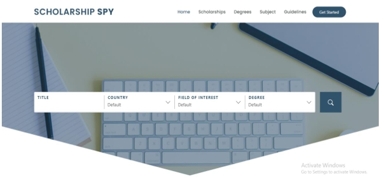
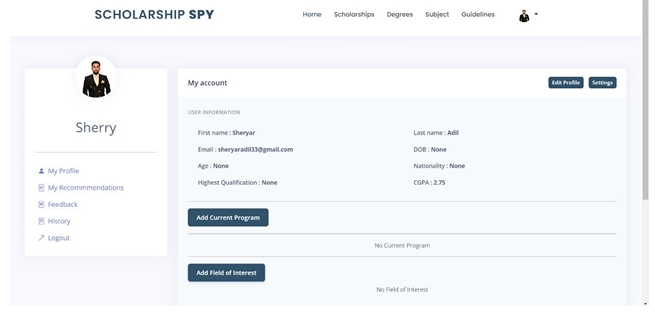

# Scholarship Spy


Scholarship Spy is a Django web app that helps students find scholarships. You can search by country, subject and degree, or paste your personal statement and get scholarships ranked by how well they match it.

## Features

- **Personalised recommendations.** Write a personal statement, **upload your CV (PDF, Word or text)**, or both. Results are ranked by relevance, with the words that explain each match. You can filter by degree level and destination, and your saved interests count too.

  <p align="center"></p>

- **Search.** Filter by title, country, subject and degree, in any combination.

  <p align="center"></p>

- **Profile and history.** Keep your profile up to date and look back at past statements and what they matched.

  <p align="center"></p>

- **Feedback.** Users can leave feedback, and the latest feedback appears on the home page.

  <p align="center"></p>

- **Admin panel.** Manage scholarships, users and recommendation history, with search and filters.

  <p align="center"></p>

## Deadlines and application tracker

- **Real deadlines.** Free-text deadlines ("31 March", "March 31, 2027", "31/03/2027"...) are parsed into dates (`app1/deadlines.py`). Dates without a year are marked *estimated* and roll forward each year. Vague text like "varies by country" is left undated rather than guessed.
- **Closing soon.** Every listing can be sorted by closing date, and cards show a coloured badge ("Closes in 9 days", "Closed").
- **Save and track.** Bookmark any scholarship, then follow it on a board through *Interested → Preparing → Applied → Interview → Successful/Unsuccessful*, with private notes. Upcoming deadlines also appear on the profile page.
- **Email reminders.** Users get one digest email 14 days and again 3 days before a saved scholarship closes, while it's still *Interested* or *Preparing*. Each reminder is sent only once per deadline. Every email has a one-click unsubscribe link, and reminders can also be turned off in the profile.

### Automatic daily jobs (no commands needed)

The site runs two jobs by itself while it's up:

| Job | When (UTC, configurable) | What it does |
|---|---|---|
| `daily_scrape` | after 03:00 (`SCRAPE_AT`) | Collects fresh scholarships from every enabled source |
| `deadline_reminders` | after 08:00 (`REMINDERS_AT`) | Emails users whose saved scholarships close soon |

Each job runs **at most once a day**, even with several server processes, because a run is claimed by a database row that can only exist once per day. If the site was asleep at the scheduled time, the job runs as soon as it wakes. Every run, with its output and any error, is listed in the admin under **Job runs**.

Other ways to run them, if you prefer:

```bash
python manage.py run_jobs --list                    # what's scheduled
python manage.py run_jobs --force deadline_reminders # run one now
python manage.py run_scheduler                      # scheduler as a separate worker
python manage.py run_jobs                           # for cron, e.g. hourly
```

Set `SCHEDULER_AUTOSTART=False` if you use the worker or cron options instead. Without SMTP settings, emails are printed to the console.

## Eligibility

Each scholarship's "who can apply" text is turned into rules (`app1/eligibility.py`) and checked against the user's nationality, highest qualification and CGPA:

- **Nationality.** "International students" (not open to nationals of the host country), "UK and EU", "developing countries", "low and middle income Commonwealth countries", "all nationalities", and lists such as Chevening's (shown as *check the official list*, never guessed). Country groups (EU, Commonwealth, World Bank high income) are in `app1/geo.py`, each noting its source and when it was checked.
- **Degree level.** Someone who already holds a master's isn't usually funded for another master's.
- **Grades.** Minimum GPA, where the listing states one.

Results are *eligible*, *not eligible* (with the reason) or *unknown*. Only clear "not eligible" results are hidden: on lists via **"Only ones I can apply for"**, and in recommendations by default with a **Show all** link. Users are always told to confirm on the official website.

## Privacy and security

- **CVs are never stored.** The text is extracted in memory, then emails, phone numbers and links are removed. Only that cleaned text is kept with your search, so the results can be refreshed later.
- Statements are sent by POST, so they never appear in URLs, server logs or browser history.
- Profile photos are checked and re-encoded, which also strips EXIF and GPS data, and saved under random names.
- Login accepts a username or email and locks out after 5 failed attempts for 15 minutes. Logging out requires a POST.
- Users can delete individual searches, clear their whole history, or delete their account and all of its data.
- New feedback appears on the home page only after an admin approves it.

## How the recommender works

It's a content-based recommender built with scikit-learn (`app1/recommender.py`).

1. **Indexing.** Each scholarship's title, subject, degree, country, university, eligibility and description become one document. Title and subject count double. The documents are turned into **TF-IDF vectors** using single words and two-word phrases, with English stop words removed and sublinear term frequency.
2. **Querying.** Your personal statement and your saved fields of interest are turned into a vector with the same vocabulary.
3. **Ranking.** Scholarships are ranked by **cosine similarity** to your statement. Weak matches are dropped, and the top 20 are saved with their rank and score.
4. **CVs and statements.** A CV is cleaned the same way and goes through the same pipeline. Common filler words ("year", "university", "experience"...) are ignored so they don't count as matches. If you don't pick a degree level, the app guesses your next one from what you've completed (for example BSc → Masters) and gives those scholarships a small boost. It ignores sentences about what you *want* to study.
5. **Explaining results.** Each result lists the strongest terms it shares with your text, and results weaker than 10% of the best match are dropped.
6. **Caching.** The index is built once and kept in memory. Django signals rebuild it whenever a scholarship is added, edited or deleted, so each request stays fast.

The tests check that results are accurate. For example, a data science statement must rank the data science scholarship first, and a renewable energy statement must rank the energy scholarship first.

> **What changed from v1:** the first version loaded a large GloVe embeddings file on every request and compared the statement to k-means cluster centres. Then it threw that result away and showed the first 20 scholarships in the database. The old research notebooks are still in `notebooks/`.

## Tech stack

Python 3.11+, Django 5.2, scikit-learn, SQLite (PostgreSQL works through environment variables), WhiteNoise, Gunicorn, HTML/CSS/JS with Bootstrap.

## Getting started

```bash
git clone https://github.com/Sherryyy00/Scholarship-Spy.git
cd Scholarship-Spy
python -m venv .venv
source .venv/bin/activate            # Windows: .venv\Scripts\activate
pip install -r requirements.txt

cp .env.example .env                 # then set DJANGO_SECRET_KEY
python manage.py migrate
python manage.py updatemodel         # loads Dataset/sample_scholarships.csv
python manage.py createsuperuser     # optional, for /admin
python manage.py runserver
```

Open http://127.0.0.1:8000.

If you don't set email credentials in `.env`, emails (such as the account verification link) are printed to the terminal instead of being sent.

### Loading real data

The sample CSV contains 12 clearly marked `[Demo]` records for local testing. To load a full scraped dataset:

```bash
python manage.py updatemodel path/to/scholarships.csv          # add or update
python manage.py updatemodel path/to/scholarships.csv --clear  # replace everything
```

The column names are flexible, and the old scraper headers (`Title`, `Links`, `apply_date`, `scholarship_details` and so on) still work. Re-running the import updates existing rows instead of creating duplicates. It also fills the country, subject and degree dropdowns.

## Live data: scrapers

Scholarship Spy collects listings automatically from public sources (`app1/scrapers/`).

| Source | What it gives | Status |
|---|---|---|
| `curated_official` | Chevening, three Commonwealth schemes and two DAAD programmes, as short summaries we wrote that link to the official pages (their sites don't permit scraping) | ✅ enabled, no network needed |
| `erasmus_mundus_rss` | The newest ~30 Erasmus Mundus Joint Masters, from the EU's official catalogue feed, with study area, duration and partner universities | ✅ enabled |
| `erasmus_mundus_catalogue` | The full catalogue (~190 programmes) with countries | 🧪 experimental, needs checking against the live page |

```bash
python manage.py scrape --list                 # see sources
python manage.py scrape                        # run all enabled sources
python manage.py scrape erasmus_mundus_catalogue --dry-run --save-html samples/
```

How it keeps data trustworthy:

- **Polite by design.** It sends a clear User-Agent, checks `robots.txt` before every request, waits 2 seconds between requests, and backs off on errors.
- **Upserts, not duplicates.** Each listing is tracked by its source and source ID, so re-runs update existing rows.
- **Freshness.** Every listing records when it was last seen. Listings that disappear from their source are hidden, never deleted. If a run suddenly finds far fewer listings (a broken parser), nothing is hidden.
- **Credit.** Each scholarship page shows its source, licence and last-checked date.
- **Audit trail.** Every run is logged in the admin under *Scrape runs* (found, new, updated, hidden, errors).

To keep the data fresh, run `python manage.py scrape` once a day. Use cron on a server, or Task Scheduler on Windows. A GitHub Action (`scraper-health.yml`) also runs a daily dry run and emails you if a source breaks.

**Adding a source:** first check the site's terms of use and `robots.txt` allow automated access. Then subclass `BaseScraper`, register it in `app1/scrapers/__init__.py`, and add a test with a saved sample page in `app1/tests_data/`.

## Running tests

```bash
python manage.py test app1
```

There are 159 tests covering recommender accuracy (statements and CVs), upload safety, login throttling, access control between users, scrapers and data ingestion, thumbnails, links, search, registration and email verification, profile security, and page rendering. GitHub Actions runs them on every push.

## Configuration

Everything that differs between environments is set through environment variables. See `.env.example` for the full list.

| Variable | Purpose |
|---|---|
| `DJANGO_SECRET_KEY` | Required when `DJANGO_DEBUG` is off |
| `DJANGO_DEBUG` | `True` for local development |
| `DJANGO_ALLOWED_HOSTS` | Comma-separated host names |
| `SITE_URL` | Public URL, used in verification emails |
| `EMAIL_HOST_USER` / `EMAIL_HOST_PASSWORD` | SMTP credentials (for Gmail, use an App Password) |
| `DB_ENGINE`, `DB_NAME`, ... | Optional, for PostgreSQL or another database |

## Deploying

```bash
python manage.py collectstatic --noinput
gunicorn project1.wsgi
```

When `DJANGO_DEBUG` is off, secure cookies and other security headers are switched on automatically.

## Future work

- Sentence-embedding model (for example `all-MiniLM-L6-v2`) as an optional upgrade to TF-IDF
- Deadline parsing and email reminders
- Verify the full Erasmus Mundus catalogue parser
- Ask DAAD and the CSC for permission or a data feed, so their full databases can be included
