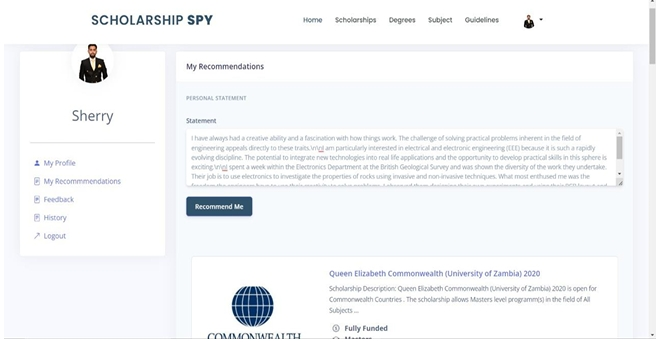
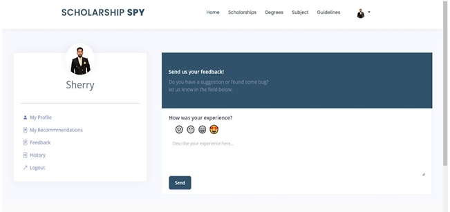
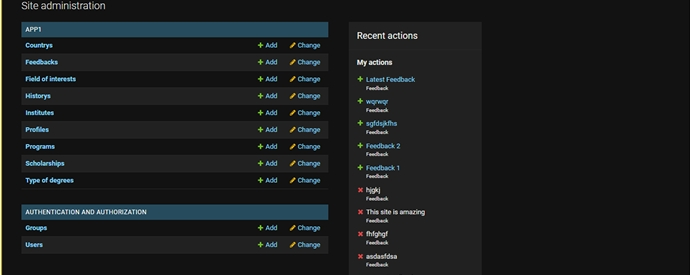

# Scholarship Spy


Scholarship Spy is a Django web app that helps students find scholarships. You can search by country, subject and degree, or paste your personal statement and get scholarships ranked by how well they match it.

## Features

- **Personalised recommendations.** Paste your personal statement and get scholarships ranked by relevance. Your saved fields of interest are taken into account too.

  <p align="center"></p>

- **Search.** Filter by title, country, subject and degree, in any combination.

  <p align="center"></p>

- **Profile and history.** Keep your profile up to date and look back at past statements and what they matched.

  <p align="center"></p>

- **Feedback.** Users can leave feedback, and the latest feedback appears on the home page.

  <p align="center"></p>

- **Admin panel.** Manage scholarships, users and recommendation history, with search and filters.

  <p align="center"></p>

## How the recommender works

It's a content-based recommender built with scikit-learn (`app1/recommender.py`).

1. **Indexing.** Each scholarship's title, subject, degree, country, university, eligibility and description become one document. Title and subject count double. The documents are turned into **TF-IDF vectors** using single words and two-word phrases, with English stop words removed and sublinear term frequency.
2. **Querying.** Your personal statement and your saved fields of interest are turned into a vector with the same vocabulary.
3. **Ranking.** Scholarships are ranked by **cosine similarity** to your statement. Weak matches are dropped, and the top 20 are saved with their rank and score.
4. **Caching.** The index is built once and kept in memory. Django signals rebuild it whenever a scholarship is added, edited or deleted, so each request stays fast.

The tests check that results are accurate. For example, a data science statement must rank the data science scholarship first, and a renewable energy statement must rank the energy scholarship first.

> **What changed from v1:** the first version loaded a large GloVe embeddings file on every request and compared the statement to k-means cluster centres. Then it threw that result away and showed the first 20 scholarships in the database. The old research notebooks are still in `notebooks/`.

## Tech stack

Python 3.11+, Django 5.2, scikit-learn, SQLite (PostgreSQL works through environment variables), WhiteNoise, Gunicorn, HTML/CSS/JS with Bootstrap.

## Getting started

```bash
git clone https://github.com/Sherryyy00/Scholarship-Spy.git
cd Scholarship-Spy
python -m venv .venv
source .venv/bin/activate            # Windows: .venv\Scripts\activate
pip install -r requirements.txt

cp .env.example .env                 # then set DJANGO_SECRET_KEY
python manage.py migrate
python manage.py updatemodel         # loads Dataset/sample_scholarships.csv
python manage.py createsuperuser     # optional, for /admin
python manage.py runserver
```

Open http://127.0.0.1:8000.

If you don't set email credentials in `.env`, emails (such as the account verification link) are printed to the terminal instead of being sent.

### Loading real data

The sample CSV contains 12 clearly marked `[Demo]` records for local testing. To load a full scraped dataset:

```bash
python manage.py updatemodel path/to/scholarships.csv          # add or update
python manage.py updatemodel path/to/scholarships.csv --clear  # replace everything
```

The column names are flexible, and the old scraper headers (`Title`, `Links`, `apply_date`, `scholarship_details` and so on) still work. Re-running the import updates existing rows instead of creating duplicates. It also fills the country, subject and degree dropdowns.

## Live data: scrapers

Scholarship Spy collects listings automatically from public sources (`app1/scrapers/`).

| Source | What it gives | Status |
|---|---|---|
| `curated_official` | Chevening, three Commonwealth schemes and two DAAD programmes, as short summaries we wrote that link to the official pages (their sites don't permit scraping) | ✅ enabled, no network needed |
| `erasmus_mundus_rss` | The newest ~30 Erasmus Mundus Joint Masters, from the EU's official catalogue feed, with study area, duration and partner universities | ✅ enabled |
| `erasmus_mundus_catalogue` | The full catalogue (~190 programmes) with countries | 🧪 experimental, needs checking against the live page |

```bash
python manage.py scrape --list                 # see sources
python manage.py scrape                        # run all enabled sources
python manage.py scrape erasmus_mundus_catalogue --dry-run --save-html samples/
```

How it keeps data trustworthy:

- **Polite by design.** It sends a clear User-Agent, checks `robots.txt` before every request, waits 2 seconds between requests, and backs off on errors.
- **Upserts, not duplicates.** Each listing is tracked by its source and source ID, so re-runs update existing rows.
- **Freshness.** Every listing records when it was last seen. Listings that disappear from their source are hidden, never deleted. If a run suddenly finds far fewer listings (a broken parser), nothing is hidden.
- **Credit.** Each scholarship page shows its source, licence and last-checked date.
- **Audit trail.** Every run is logged in the admin under *Scrape runs* (found, new, updated, hidden, errors).

To keep the data fresh, run `python manage.py scrape` once a day. Use cron on a server, or Task Scheduler on Windows. A GitHub Action (`scraper-health.yml`) also runs a daily dry run and emails you if a source breaks.

**Adding a source:** first check the site's terms of use and `robots.txt` allow automated access. Then subclass `BaseScraper`, register it in `app1/scrapers/__init__.py`, and add a test with a saved sample page in `app1/tests_data/`.

## Running tests

```bash
python manage.py test app1
```

There are 67 tests covering recommender accuracy, scrapers and data ingestion, thumbnails, links, search, registration and email verification, profile security, and page rendering. GitHub Actions runs them on every push.

## Configuration

Everything that differs between environments is set through environment variables. See `.env.example` for the full list.

| Variable | Purpose |
|---|---|
| `DJANGO_SECRET_KEY` | Required when `DJANGO_DEBUG` is off |
| `DJANGO_DEBUG` | `True` for local development |
| `DJANGO_ALLOWED_HOSTS` | Comma-separated host names |
| `SITE_URL` | Public URL, used in verification emails |
| `EMAIL_HOST_USER` / `EMAIL_HOST_PASSWORD` | SMTP credentials (for Gmail, use an App Password) |
| `DB_ENGINE`, `DB_NAME`, ... | Optional, for PostgreSQL or another database |

## Deploying

```bash
python manage.py collectstatic --noinput
gunicorn project1.wsgi
```

When `DJANGO_DEBUG` is off, secure cookies and other security headers are switched on automatically.

## Future work

- Sentence-embedding model (for example `all-MiniLM-L6-v2`) as an optional upgrade to TF-IDF
- Deadline parsing and email reminders
- Verify the full Erasmus Mundus catalogue parser
- Ask DAAD and the CSC for permission or a data feed, so their full databases can be included
